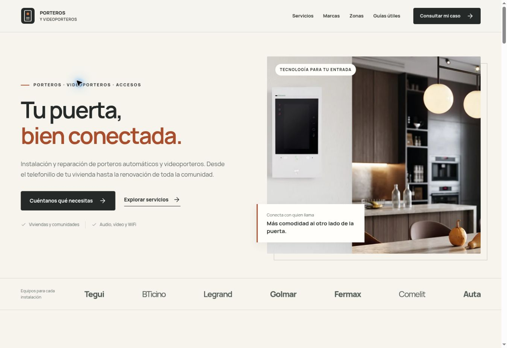

# Porteros y Videoporteros

Web de instalación y reparación de porteros automáticos y videoporteros, creada desde cero para este repositorio. Diseño propio en marfil, grafito y cobre; HTML estático, CSS adaptable y JavaScript pequeño para navegación, búsqueda municipal y preparación de consultas.

## Vistas y revisión



- [Portada y municipio en móvil](docs/porteros-mobile-1793002017828.jpg).
- [Teléfonos por zona en móvil](docs/contactos-movil-1793004436248.jpg).
- [Municipios destacados en el index](docs/municipios-index-1793005907781.jpg).
- [Nuevo pie con teléfonos, WhatsApp y mapa](docs/footer-cobertura-1793006025098.jpg).
- [Inicio, municipios y mapa en móvil](docs/contacto-municipios-movil-1793006009958.jpg).
- [Portero automático de audio en el inicio](docs/portero-audio-index-1793008163529.jpg).
- [Barrios de Oviedo con fuente municipal](docs/barrios-municipales-oviedo-1793008193662.jpg).
- [Fotos de audio y barrios en móvil](docs/audio-barrios-movil-1793008402413.jpg).
- [Auditoría de variedad editorial y límites](docs/content-audit.md), con [muestra reproducible](docs/content-audit.json).

## Contenido incluido

| Tipo | Cantidad |
| --- | ---: |
| Municipios | 3.797 |
| Provincias | 19 |
| Servicios | 8 |
| Marcas con fotografía propia de fabricante | 7 |
| Guías prácticas | 5 |
| Síntomas de avería disponibles | 48 |
| Preguntas frecuentes disponibles | 48 |
| Enfoques editoriales locales | 12 |
| Páginas HTML generadas | 3.846 |
| Municipios con referencias municipales verificadas | 44 |
| Barrios documentados por sus ayuntamientos | 371 |
| Distritos municipales | 6 |
| Urbanizaciones y zonas residenciales | 9 |
| Fuentes municipales de zonas | 56 |

La portada incluye también una fotografía real del portero de audio Fermax City VEO DUOX PLUS 49202, con placa exterior y telefonillo con auricular. La página de telefonillos muestra el terminal de audio VEO 3444. Ambas imágenes proceden de las fichas oficiales y conservan crédito, referencia y texto alternativo.

Las marcas son **Tegui, BTicino, Legrand, Golmar, Fermax, Comelit y Auta**. Los servicios cubren instalación/renovación, reparación, comunidades, telefonillos y monitores, WiFi/móvil, apertura y accesos, casas/negocios y mantenimiento.

### Cobertura

Asturias (78), Cantabria (102), Bizkaia (113), Gipuzkoa (88), León (211), Palencia (191), Álava (51), Navarra (272), Zamora (248), Valladolid (225), Burgos (371), La Rioja (174), Salamanca (362), Ávila (248), Segovia (209), Soria (183), Toledo (204), Madrid (179) y Guadalajara (288).

La portada muestra **95 municipios destacados**, cinco por provincia, con enlaces HTML directos a sus páginas de servicio y acceso a cada directorio provincial completo. La selección utiliza la población del conjunto de datos municipal existente; se presenta como una selección de localidades, sin afirmar un ranking demográfico actualizado. El buscador sigue dando acceso a los 3.797 municipios.

## Ejecutar y verificar

Requiere Node.js 22 o posterior. No hay paquetes de producción que instalar ni descargas remotas durante el build.

```bash
npm run build
npm run check
npm test
```

`dist/` contiene la web generada y se excluye de Git. `qa/` contiene informes locales de build y validación, también excluidos de Git.

Sin dominio configurado, el build local incluye `noindex` y omite las canonical. Para comprobar la variante de producción con un origen de prueba, sin publicarla:

```bash
SITE_URL=https://porteros.example npm run build
npm run check
```

**No utilizar `porteros.example` como dominio de producción.** Es exclusivamente un origen de prueba y no está guardado en la configuración del sitio.

El validador comprueba la coherencia de versiones de recursos, el teléfono y provincia de las páginas locales, y todos los HTML, rutas municipales, enlaces internos y anclas, imágenes/fuentes/JS/CSS, unicidad de títulos/descripciones, canonical, JSON-LD y sitemaps. Las pruebas cubren asignación completa de teléfonos, rechazo de provincias sin contacto o duplicadas, selección estable de síntomas de distintos tipos, pertenencia y categoría de las zonas residenciales, identidad de sus fuentes municipales y exclusión de áreas industriales, normalización del origen, proximidad geográfica y escape del contenido.

## Desplegar en Netlify

Importar este repositorio con la rama `main`. `netlify.toml` ya establece:

```text
Build command: npm run build:production && npm run check
Publish directory: dist
Node: 22
```

El origen se obtiene por este orden:

1. Variable `SITE_URL`.
2. `siteUrl` en `data/site.json`.
3. Variable `URL` que proporciona Netlify para el sitio.

Al asignar el dominio definitivo, establecer `SITE_URL` con ese origen HTTPS, sin ruta ni parámetros, y reconstruir. Los títulos, canonical, JSON-LD y sitemaps se generan juntos para evitar mezclar dominios. Los deploy previews de Netlify (`CONTEXT` distinto de `production`) llevan `noindex`.

Con un origen de producción se generan **3.843 páginas indexables**: el resto son privacidad, información legal y error 404. `sitemap.xml` es un índice de `sitemap-general.xml` y los 19 sitemaps provinciales. El total es 21 archivos XML contando el índice. `robots.txt` incluye el sitemap de producción.

Los errores de ruta mantienen un estado 404 mediante la configuración de Netlify. No se usa una reescritura global a la portada.

## Teléfonos por provincia

Los números facilitados por el titular están configurados en `data/site.json`, tanto para llamada como para preparar una consulta en WhatsApp:

| Provincias | Teléfono |
| --- | --- |
| Madrid, Guadalajara y Toledo | **614 78 99 45** |
| Asturias, Cantabria, Bizkaia, Gipuzkoa, Álava, Navarra, La Rioja y las nueve provincias de Castilla y León | **670 042 626** |

Cada página de municipio o provincia selecciona su zona. La cabecera, el pie, la consulta y la barra móvil muestran su teléfono. La portada y las páginas generales utilizan **670 042 626** como contacto y WhatsApp predeterminados; el pie identifica también la línea de Madrid, Guadalajara y Toledo. Los enlaces directos de WhatsApp funcionan sin rellenar un formulario. El formulario detallado conserva el selector de provincia para dirigir cada consulta. Cambiar de provincia en el formulario actualiza el destinatario, los teléfonos de consulta y cabecera, y los accesos móviles de llamada/WhatsApp; limpia la ubicación anterior y retira sugerencias de otra provincia. Las dos zonas etiquetadas del pie mantienen sus teléfonos correspondientes.

El formulario prepara el texto localmente y abre `wa.me` a petición del visitante. El envío se confirma dentro de WhatsApp, y también existe la opción de copiar. Sin JavaScript, la preparación de mensajes queda deshabilitada; los enlaces de llamada siguen funcionando. No se crea una reserva ni se transmite la consulta automáticamente. La asociación del número con una cuenta activa de WhatsApp no se ha comprobado mediante un mensaje real.

La franja superior muestra **«Urgencias 24 horas»**, según la indicación del titular. El pie combina contacto directo, accesos a provincias y un mapa vectorial de España con las 19 provincias de servicio: norte y Castilla y León en salvia; Madrid, Guadalajara y Toledo en cobre. El mapa es una obra derivada de cartografía oficial del IGN bajo CC BY 4.0, con atribución visible y créditos ampliados. [Fuente y generación del mapa](docs/coverage-map-sources.md).

## Datos pendientes del titular

Siguen pendientes el dominio definitivo, correo, nombre o razón social, NIF y domicilio legal. Se completan en `data/site.json` o mediante variables de entorno:

| Variable | Uso |
| --- | --- |
| `SITE_URL` | Origen HTTPS definitivo |
| `CONTACT_PHONE_CENTRO`, `CONTACT_WHATSAPP_CENTRO` | Sustitución opcional de la línea de Madrid, Guadalajara y Toledo |
| `CONTACT_PHONE_NORTE`, `CONTACT_WHATSAPP_NORTE` | Sustitución opcional de la línea de zona norte y Castilla y León |
| `CONTACT_EMAIL` | Correo comercial |
| `LEGAL_NAME` | Titular o razón social |
| `LEGAL_TAX_ID` | NIF del titular |
| `LEGAL_ADDRESS` | Domicilio legal |

Los teléfonos de configuración llevan prefijo `+34` y nueve cifras. Las variables genéricas `CONTACT_PHONE` y `CONTACT_WHATSAPP` permiten sustituir el contacto predeterminado de la portada y páginas generales; no reemplazan las asignaciones provinciales actuales.

No se han añadido analítica, píxeles publicitarios ni mapas de terceros. La información de privacidad y del titular indica expresamente qué datos identificativos quedan pendientes.

## Organización del código

```text
data/site.json                 Identidad y contacto
data/brands.json               Marcas, fotografías y procedencia
data/hero.json                 Fotografía de ambiente y crédito
data/services.json             Servicios y comprobaciones
data/diagnostics.json          Síntomas y orientación inicial
data/faqs.json                 Preguntas frecuentes
data/guides.json               Guías con documentación oficial
data/local-focus.json          Enfoques editoriales diferenciados
data/municipalities.json       Municipios y coordenadas
data/geography-sources.json    Fuentes, fecha y límites geográficos
scripts/build.mjs             Generación y configuración SEO
scripts/components.mjs        Componentes compartidos
scripts/pages.mjs             Composición de tipos de página
scripts/utils.mjs             Rutas, selección, escape y proximidad
scripts/check.mjs             Validación completa del resultado
scripts/contact.mjs           Asignación de teléfonos por provincia
scripts/audit-content.py       Comparación antes/después con pares fijos
data/localities.json           Barrios, distritos y zonas con fuente municipal
data/audio-entry.json          Fotografías oficiales de porteros de audio
tests/contact.test.mjs         Enrutamiento y pertenencia geográfica
public/assets/site.css        Diseño original y adaptación móvil
public/assets/site.js         Menú, búsqueda, filtros y consulta
tests/core.test.mjs            Pruebas del comportamiento crítico
```

## Contenido local y SEO

Las rutas municipales siguen este formato:

```text
/porteros-videoporteros/asturias/oviedo/
/porteros-videoporteros/bizkaia/barakaldo/
/porteros-videoporteros/madrid/alcala-de-henares/
```

Cada municipio tiene un H1 centrado en «Instalación y reparación de porteros automáticos y videoporteros en…», metadatos propios, navegación de provincia, fotografías, preguntas visibles, formulario con su localidad y enlaces de proximidad.

La selección editorial es **determinista**, basada en el código INE. No cambia al azar en cada build ni atribuye necesidades concretas al municipio. Combina enfoques, apartados complementarios, diagnósticos, servicios, marcas y preguntas. Los casos se describen como orientación técnica, nunca como trabajos realizados o averías verificadas en ese pueblo. Todos los servicios siguen accesibles desde cualquier localidad.

El directorio `/averias/` permite buscar entre los 48 casos por palabra o por tipo. Cada municipio incorpora cuatro diagnósticos: uno relacionado con su enfoque y otros tres de tipos diferentes. Todo el catálogo sigue accesible, aunque un caso no aparezca en la selección local.

En 44 páginas se muestran 386 referencias obtenidas de 56 fuentes municipales: 371 barrios, seis distritos y nueve urbanizaciones o zonas residenciales, con presencia en las 19 provincias. Se ha retirado por completo la selección anterior del Nomenclátor y su importador. Cada referencia conserva su categoría y fuente del ayuntamiento; al elegirla se completa municipio, provincia y zona en el formulario. Las sugerencias se vinculan al municipio y a su provincia, y la zona se limpia al cambiar de localidad. Donde no hay referencias municipales comprobadas se omite el bloque. No se infieren códigos postales. [Criterios, cobertura y fuentes](docs/localities-sources.md).

La auditoría histórica anterior a esta sustitución conserva exactamente los 240 pares originales y distingue el contenido completo del contenido sin la sección geográfica. Sus cifras documentan aquella revisión; no son una medición del catálogo municipal actual. [Informe histórico y métricas](docs/content-audit.md).

Una medición de similitud textual es una herramienta interna, no un porcentaje que Google emplee ni una garantía de indexación. La estructura y parte del contenido se comparten entre municipios. La siguiente mejora editorial debe partir de información real: trabajos documentados, condiciones de servicio verificadas y preguntas de clientes; no de inventar reseñas, calles, oficinas o estadísticas.

Referencias SEO: [guía de Google](https://developers.google.com/search/docs/fundamentals/seo-starter-guide), [contenido útil](https://developers.google.com/search/docs/fundamentals/creating-helpful-content), [políticas sobre contenido a escala](https://developers.google.com/search/docs/essentials/spam-policies).

## Fuentes y derechos

- Nombres y códigos: [INE, relación a 1 de enero de 2026](https://www.ine.es/daco/daco42/codmun/26codmun.xlsx).
- Coordenadas: [IGN, Información Geográfica Destacada](https://www.ign.es/web/ign/portal/ane-datos-geograficos), revisión 20/10/2025. Atribución CC BY 4.0, ign.es, 2025. Las distancias sirven para seleccionar localidades próximas, no para prometer kilómetros por carretera.
- La población del archivo IGN solo ordena localidades destacadas. No se muestra como cifra actual: la fuente no especifica el año censal de ese campo.
- Fotos: fuentes oficiales registradas por imagen en `data/brands.json`, `data/hero.json` y `data/audio-entry.json`. Las marcas y fotografías pertenecen a sus respectivos titulares. No se atribuyen a obras propias ni implican servicio técnico oficial.
- Manrope: fuente local con licencia SIL Open Font License incluida en `public/assets/fonts/OFL-Manrope.txt`.
- [Fuentes del catálogo de averías](docs/diagnostic-sources.md): documentación oficial de fabricantes y criterios de redacción original.
- [Barrios y zonas municipales](docs/localities-sources.md): 56 fuentes de ayuntamientos, con categoría, evidencia y fecha de consulta por referencia.
- Las guías incorporan fuentes técnicas oficiales. WiFi no se equipara a ausencia de cables ni se supone compatibilidad entre equipos solo por tener dos hilos.

## Estado de entrega

Código listo para compilar en Netlify y guardarse en la rama principal del repositorio solicitado. La puesta en servicio comercial requiere completar los datos reales anteriores. Una subida a GitHub no confirma por sí sola un despliegue en Netlify ni la indexación en buscadores.
